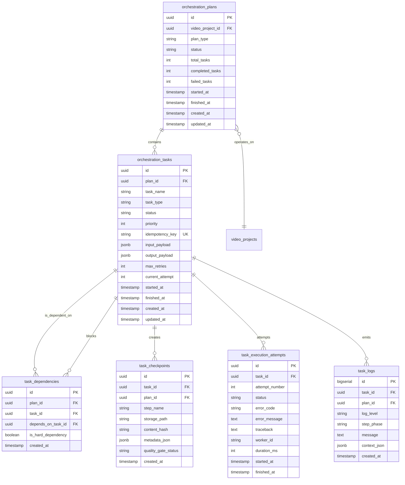

# DATA_MODEL.md
# Mô Hình Dữ Liệu Chi Tiết — Autonomous Task Orchestrator & Pipeline Database

**Phiên bản:** 1.0.0  
**Tình trạng:** Master Data Architecture Document  
**Cơ sở dữ liệu:** PostgreSQL 16  
**ORM:** SQLAlchemy 2.x  
**Migration:** Alembic  
**Căn cứ đặc tả:** `PROJECT.md` (Phần XII, XIII, XXV)

---

## 1. Sơ Đồ Thực Thể & Mối Quan Hệ (ERD - Orchestration Layer)



---

## 2. Đặc Tả Chi Tiết Các Bảng Dữ Liệu

### 2.1. Bảng `orchestration_plans`
Lưu trữ phiên bản kế hoạch DAG hoàn chỉnh cho một mục tiêu sản xuất video hoặc xử lý nguồn.

| Cột | Kiểu dữ liệu | Ràng buộc | Mô tả |
| :--- | :--- | :--- | :--- |
| `id` | `UUID` | `PRIMARY KEY, DEFAULT gen_random_uuid()` | Khóa chính của Plan |
| `video_project_id` | `UUID` | `FOREIGN KEY -> video_projects(id), NULLABLE` | Liên kết dự án video tương ứng |
| `plan_type` | `VARCHAR(64)` | `NOT NULL` | Loại kế hoạch: `URL_TO_VIDEO`, `TREND_TO_VIDEO`, `RE_RENDER_STAGE`, `BATCH_MCN_PUBLISH` |
| `status` | `VARCHAR(32)` | `NOT NULL, DEFAULT 'pending'` | Enum: `pending`, `running`, `paused`, `completed`, `failed`, `cancelled` |
| `total_tasks` | `INTEGER` | `NOT NULL, DEFAULT 0` | Tổng số tác vụ trong DAG |
| `completed_tasks` | `INTEGER` | `NOT NULL, DEFAULT 0` | Số tác vụ đã hoàn thành thành công |
| `failed_tasks` | `INTEGER` | `NOT NULL, DEFAULT 0` | Số tác vụ thất bại |
| `context_metadata` | `JSONB` | `DEFAULT '{}'` | Tham số mục tiêu ban đầu (URL, cấu hình giọng đọc, template, niche) |
| `started_at` | `TIMESTAMP WITH TIME ZONE` | `NULLABLE` | Thời điểm bắt đầu chạy tác vụ đầu tiên |
| `finished_at` | `TIMESTAMP WITH TIME ZONE` | `NULLABLE` | Thời điểm toàn bộ DAG hoàn tất |
| `created_at` | `TIMESTAMP WITH TIME ZONE` | `NOT NULL, DEFAULT NOW()` | Thời điểm tạo plan |
| `updated_at` | `TIMESTAMP WITH TIME ZONE` | `NOT NULL, DEFAULT NOW()` | Thời điểm cập nhật cuối |

---

### 2.2. Bảng `orchestration_tasks`
Lưu trữ từng đơn vị công việc (Task Node) trong đồ thị DAG.

| Cột | Kiểu dữ liệu | Ràng buộc | Mô tả |
| :--- | :--- | :--- | :--- |
| `id` | `UUID` | `PRIMARY KEY, DEFAULT gen_random_uuid()` | Khóa chính của Task |
| `plan_id` | `UUID` | `NOT NULL, FOREIGN KEY -> orchestration_plans(id) ON DELETE CASCADE` | Thuộc về Plan nào |
| `task_name` | `VARCHAR(128)` | `NOT NULL` | Tên tác vụ người dùng đọc được (VD: `Crawl VnExpress Article`) |
| `task_type` | `VARCHAR(64)` | `NOT NULL` | Loại nghiệp vụ: `CRAWL_SOURCE`, `EXTRACT_FACTS`, `GENERATE_SCRIPT`, `TTS_AUDIO`, `ALIGN_AUDIO`, `SEARCH_MEDIA`, `VERIFY_RIGHTS`, `RENDER_FFMPEG`, `QUALITY_GATE_CHECK`, `PUBLISH_POST` |
| `status` | `VARCHAR(32)` | `NOT NULL, DEFAULT 'pending'` | Enum: `pending`, `queued`, `running`, `retrying`, `blocked`, `completed`, `failed`, `cancelled` |
| `priority` | `INTEGER` | `NOT NULL, DEFAULT 10` | Mức ưu tiên (Số càng nhỏ ưu tiên càng cao: 1 = Critical, 10 = Normal) |
| `idempotency_key` | `VARCHAR(128)` | `NOT NULL, UNIQUE` | Khóa chống chạy trùng lặp: `hash(plan_id + task_type + input_hash)` |
| `input_payload` | `JSONB` | `NOT NULL, DEFAULT '{}'` | Dữ liệu đầu vào hoặc tham chiếu checkpoint từ bước trước |
| `output_payload` | `JSONB` | `DEFAULT '{}'` | Kết quả đầu ra có cấu trúc của task |
| `max_retries` | `INTEGER` | `NOT NULL, DEFAULT 3` | Số lần thử lại tối đa cho lỗi tạm thời |
| `current_attempt` | `INTEGER` | `NOT NULL, DEFAULT 0` | Số lần đã thực thi |
| `timeout_seconds` | `INTEGER` | `NOT NULL, DEFAULT 300` | Giới hạn thời gian tối đa trước khi timeout |
| `started_at` | `TIMESTAMP WITH TIME ZONE` | `NULLABLE` | Thời điểm bắt đầu chạy lần gần nhất |
| `finished_at` | `TIMESTAMP WITH TIME ZONE` | `NULLABLE` | Thời điểm kết thúc |
| `created_at` | `TIMESTAMP WITH TIME ZONE` | `NOT NULL, DEFAULT NOW()` | Thời điểm tạo task |
| `updated_at` | `TIMESTAMP WITH TIME ZONE` | `NOT NULL, DEFAULT NOW()` | Thời điểm cập nhật cuối |

---

### 2.3. Bảng `task_dependencies`
Xác định quan hệ cạnh (Edge) có hướng giữa các Task trong DAG.

| Cột | Kiểu dữ liệu | Ràng buộc | Mô tả |
| :--- | :--- | :--- | :--- |
| `id` | `UUID` | `PRIMARY KEY, DEFAULT gen_random_uuid()` | Khóa chính quan hệ phụ thuộc |
| `plan_id` | `UUID` | `NOT NULL, FOREIGN KEY -> orchestration_plans(id) ON DELETE CASCADE` | Thuộc về Plan nào |
| `task_id` | `UUID` | `NOT NULL, FOREIGN KEY -> orchestration_tasks(id) ON DELETE CASCADE` | Task nhận phụ thuộc (Task con) |
| `depends_on_task_id` | `UUID` | `NOT NULL, FOREIGN KEY -> orchestration_tasks(id) ON DELETE CASCADE` | Task điều kiện (Task cha) |
| `is_hard_dependency` | `BOOLEAN` | `NOT NULL, DEFAULT TRUE` | `TRUE`: Cha fail thì con `blocked`. `FALSE`: Cho phép chạy fallback |
| `created_at` | `TIMESTAMP WITH TIME ZONE` | `NOT NULL, DEFAULT NOW()` | Thời điểm thiết lập quan hệ |

*Ràng buộc toàn vẹn:* `UNIQUE(task_id, depends_on_task_id)` ngăn trùng lặp quan hệ.

---

### 2.4. Bảng `task_checkpoints`
Lưu trữ đầu ra bền vững sau khi vượt qua Quality Gate để hỗ trợ tự phục hồi.

| Cột | Kiểu dữ liệu | Ràng buộc | Mô tả |
| :--- | :--- | :--- | :--- |
| `id` | `UUID` | `PRIMARY KEY, DEFAULT gen_random_uuid()` | Khóa chính Checkpoint |
| `task_id` | `UUID` | `NOT NULL, FOREIGN KEY -> orchestration_tasks(id) ON DELETE CASCADE` | Khởi tạo từ Task nào |
| `plan_id` | `UUID` | `NOT NULL, FOREIGN KEY -> orchestration_plans(id) ON DELETE CASCADE` | Thuộc về Plan nào |
| `step_name` | `VARCHAR(64)` | `NOT NULL` | Tên bước: `SCRIPT_JSON`, `VOICE_AUDIO`, `SUBTITLE_ALIGNMENT`, `RENDER_MP4` |
| `storage_path` | `VARCHAR(512)` | `NULLABLE` | Đường dẫn tệp media trên local storage / S3 bucket |
| `content_hash` | `VARCHAR(64)` | `NOT NULL` | Mã băm SHA-256 bảo đảm tính toàn vẹn của tệp |
| `metadata_json` | `JSONB` | `NOT NULL, DEFAULT '{}'` | Dữ liệu cấu trúc (ffprobe metadata, tokens usage, word timestamps) |
| `quality_gate_status` | `VARCHAR(32)` | `NOT NULL, DEFAULT 'PASSED'` | Kết quả kiểm định: `PASSED`, `FAILED_RETRYING`, `MANUAL_OVERRIDE` |
| `created_at` | `TIMESTAMP WITH TIME ZONE` | `NOT NULL, DEFAULT NOW()` | Thời điểm lưu checkpoint |

---

### 2.5. Bảng `task_execution_attempts`
Ghi nhận từng lần thực thi của một task để phục vụ chẩn đoán lỗi, tính toán backoff và báo cáo lỗi trung thực.

| Cột | Kiểu dữ liệu | Ràng buộc | Mô tả |
| :--- | :--- | :--- | :--- |
| `id` | `UUID` | `PRIMARY KEY, DEFAULT gen_random_uuid()` | Khóa chính Attempt |
| `task_id` | `UUID` | `NOT NULL, FOREIGN KEY -> orchestration_tasks(id) ON DELETE CASCADE` | Liên kết Task |
| `attempt_number` | `INTEGER` | `NOT NULL` | Lần thử thứ mấy (1, 2, 3...) |
| `status` | `VARCHAR(32)` | `NOT NULL` | Kết quả lần thử: `SUCCESS`, `TEMPORARY_ERROR`, `FATAL_ERROR`, `TIMEOUT` |
| `error_code` | `VARCHAR(64)` | `NULLABLE` | Mã lỗi chuẩn hóa: `HTTP_429_RATE_LIMIT`, `HTTP_401_UNAUTHORIZED`, `FFMPEG_CRASH`, `GATE_VALIDATION_FAILED` |
| `error_message` | `TEXT` | `NULLABLE` | Thông báo lỗi không chứa dữ liệu bí mật (No secrets) |
| `traceback` | `TEXT` | `NULLABLE` | Chi tiết stack trace cho môi trường dev/debug |
| `worker_id` | `VARCHAR(64)` | `NULLABLE` | Mã định danh worker đã xử lý lần thử này |
| `duration_ms` | `INTEGER` | `NOT NULL, DEFAULT 0` | Thời gian chạy thực tế (mili-giây) |
| `started_at` | `TIMESTAMP WITH TIME ZONE` | `NOT NULL` | Thời điểm bắt đầu |
| `finished_at` | `TIMESTAMP WITH TIME ZONE` | `NULLABLE` | Thời điểm kết thúc |

---

### 2.6. Bảng `task_logs`
Nhật ký thực thi phân tầng có cấu trúc phục vụ giám sát và gỡ lỗi.

| Cột | Kiểu dữ liệu | Ràng buộc | Mô tả |
| :--- | :--- | :--- | :--- |
| `id` | `BIGSERIAL` | `PRIMARY KEY` | Khóa tự tăng |
| `task_id` | `UUID` | `NOT NULL, FOREIGN KEY -> orchestration_tasks(id) ON DELETE CASCADE` | Thuộc Task nào |
| `plan_id` | `UUID` | `NOT NULL, FOREIGN KEY -> orchestration_plans(id) ON DELETE CASCADE` | Thuộc Plan nào |
| `log_level` | `VARCHAR(16)` | `NOT NULL` | Enum: `DEBUG`, `INFO`, `WARNING`, `ERROR` |
| `step_phase` | `VARCHAR(64)` | `NOT NULL` | Pha xử lý (VD: `AI_PROMPT_DISPATCH`, `FFMPEG_ENCODE_PASS_1`) |
| `message` | `TEXT` | `NOT NULL` | Nội dung thông điệp |
| `context_json` | `JSONB` | `DEFAULT '{}'` | Dữ liệu ngữ cảnh không chứa token hay secret |
| `created_at` | `TIMESTAMP WITH TIME ZONE` | `NOT NULL, DEFAULT NOW()` | Thời điểm ghi log |

---

## 3. Chiến Lược Chỉ Mục (Indexing Strategy)

```sql
-- Tìm kiếm các task sẵn sàng chạy (Dependency resolver polling)
CREATE INDEX idx_tasks_status_priority ON orchestration_tasks (status, priority, created_at);

-- Tìm task theo plan để render tiến độ DAG trên Dashboard
CREATE INDEX idx_tasks_plan_status ON orchestration_tasks (plan_id, status);

-- Khóa Idempotency truy vấn siêu nhanh
CREATE UNIQUE INDEX idx_tasks_idempotency_key ON orchestration_tasks (idempotency_key);

-- Tìm các task con phụ thuộc khi task cha hoàn thành
CREATE INDEX idx_task_deps_parent ON task_dependencies (depends_on_task_id);
CREATE INDEX idx_task_deps_child ON task_dependencies (task_id);

-- Checkpoint lookup khi khôi phục sau crash
CREATE INDEX idx_checkpoints_task_id ON task_checkpoints (task_id);
CREATE INDEX idx_checkpoints_plan_step ON task_checkpoints (plan_id, step_name);

-- Nhật ký log sắp xếp theo thời gian
CREATE INDEX idx_logs_task_created ON task_logs (task_id, created_at);
```

---
*Mô hình dữ liệu này cung cấp nền móng vững chắc cho Autonomous Task Orchestration, ngăn chặn tình trạng đứt gãy quy trình và bảo toàn dữ liệu.*
